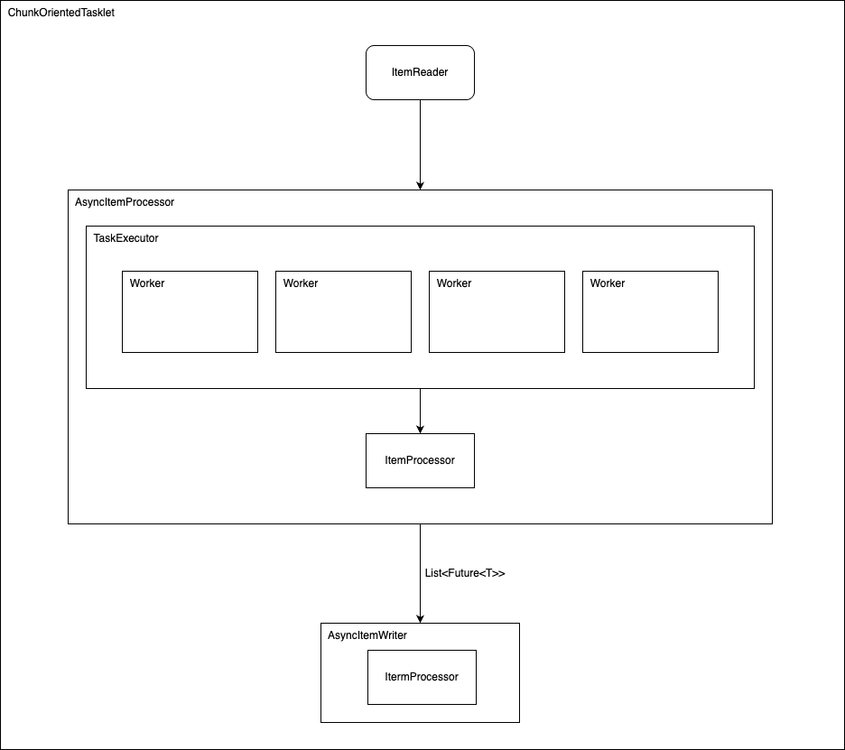
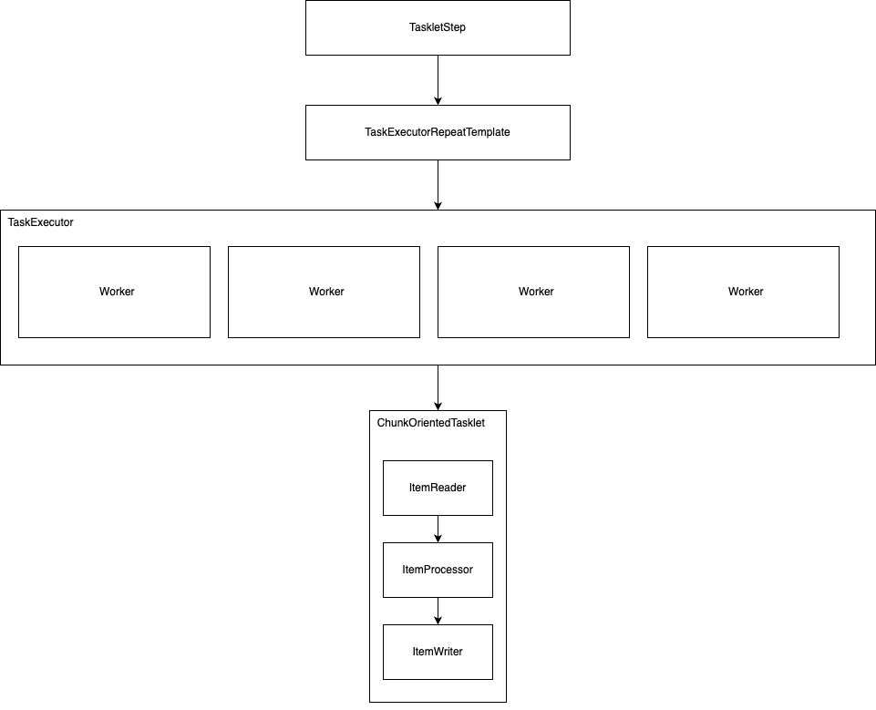
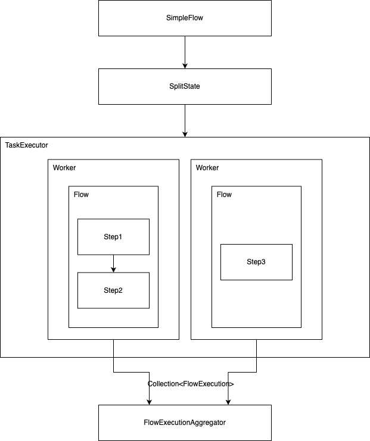
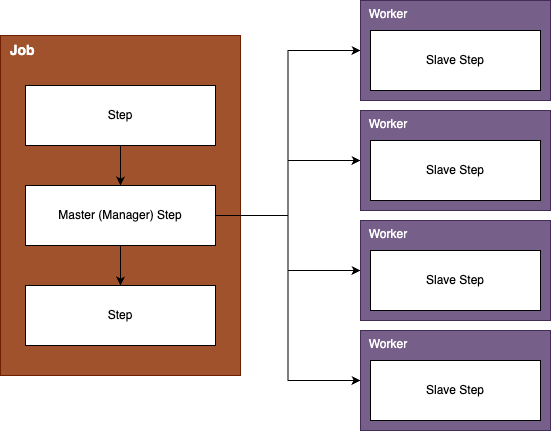
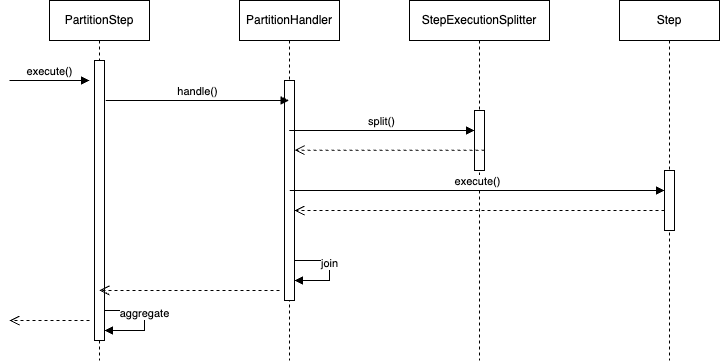
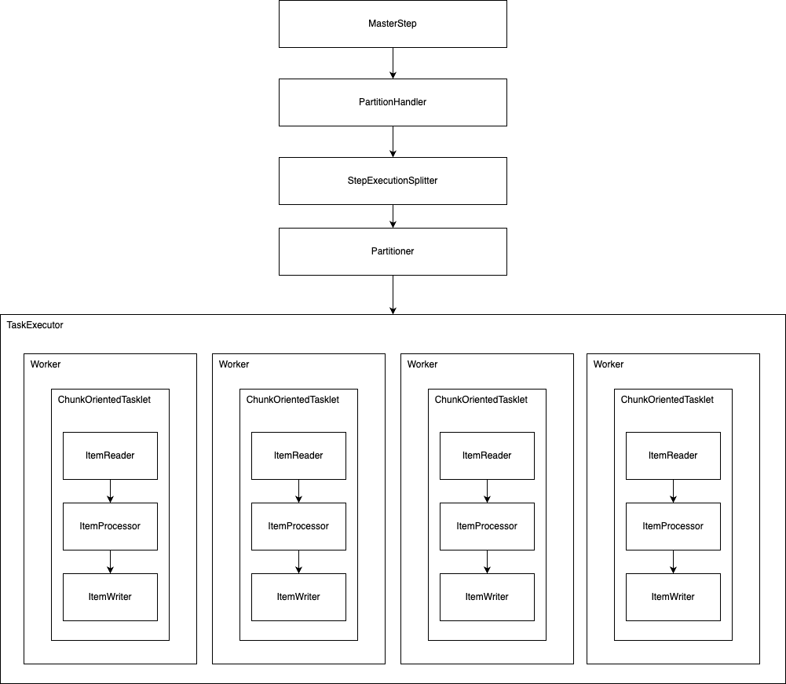

##  Asynchronous Processors

```ChunkOrientedTasklet```에서 Processing 과정을 멀티 스레드로 수행할 수 있다. 
```AsyncItemProcessor```는 ```TaskExecutor```와 ```ItemProcessor```의 데코레이터 역할을 하며 Processing 결과는 ```Future```로 반환된다. 
```AsyncWriter```는 ```Future```를 un-wrapping 하는 역할을 하기에 주로 함께 사용된다.

``` java
@Bean
public AsyncItemProcessor processor(ItemProcessor itemProcessor, TaskExecutor taskExecutor) {
    AsyncItemProcessor asyncItemProcessor = new AsyncItemProcessor();
    asyncItemProcessor.setTaskExecutor(taskExecutor);
    asyncItemProcessor.setDelegate(itemProcessor);
    return asyncItemProcessor;
}
```

``` java
@Bean
public AsyncItemWriter writer(ItemWriter itemWriter) {
    AsyncItemWriter asyncItemWriter = new AsyncItemWriter();
    asyncItemWriter.setDelegate(itemWriter);
    return asyncItemWriter;
}
```



## Multi Thread Step

가장 간단한 방법으로는 ```Step```에 ```TaskExecutor```를 지정함으로서 ```Step``` 자체를 병렬 처리하는 것이다. 

이 경우 ```TaskExecutorRepeatTemplate```를 통해 제어된다. 
여기에 스로틀 값이 디폴트로 4로 지정되어 있기에, 스레드 풀을 완전히 사용하기 위해서는 이 값도 조절해줘야 한다.

하지만 스로틀 값은 v5 이 후로는 Deprecated 되었으며 이 기능을 더 이상 제공하지 않는다. 
이 버전 이 후로는 ```ThreadPoolTaskExecutor```과 같은 한정된 리소스를 가지고 있는 구현체를 사용하는 것이 좋다.

``` java
@Bean
public TaskExecutor taskExecutor() {
    return new SimpleAsyncTaskExecutor("spring_batch");
}

@Bean
public Step sampleStep(TaskExecutor taskExecutor, JobRepository jobRepository, PlatformTransactionManager transactionManager) {
	return new StepBuilder("sampleStep", jobRepository)
				.<String, String>chunk(10, transactionManager)
				.reader(itemReader())
				.writer(itemWriter())
				.taskExecutor(taskExecutor)
        .throttleLimit(20)
				.build();
}
```

``` java
@Deprecated(
    since = "5.0",
    forRemoval = true
)
public B throttleLimit(int throttleLimit) {
    this.throttleLimit = throttleLimit;
    return (AbstractTaskletStepBuilder)this.self();
}
```

Multi Thread Step에서 주의해야할 점은 관련된 컴포넌트들이 Thread Safe한지를 검증해야 한다. 
많은 구현체들이 멀티 스레드 환경이 고려되지 않은 채 설계되었으며다. 
특히 Reader의 경우에는 하나의 소스에서 데이터를 읽어와야 하는데 ```PagingItemReader``` 쪽 구현체 외에는 stateful한 방법으로 구현되었으며 이들은 Thread Safe 하지 않다. 
반면 Processor, Writer에서는 이미 스택 내에 독립된 Chunk를 가지고 있기 때문에 stateful한 구현이 많지는 않다. 

직접 Thread Safe한 방식으로 구현할 수도 있지만 ```SynchronizedItemStreamReader```라는 데코레이터 클래스를 사용할 수도 있다. 
복잡한 구현은 없고 deletegate를 위해 ```ItemStreamReader```를 인자로 받고, ```read``` 작업을 ```synchronized``` 키워드로 제어한다.

``` java
public class SynchronizedItemStreamReader<T> implements ItemStreamReader<T>, InitializingBean {
    private ItemStreamReader<T> delegate;

    public SynchronizedItemStreamReader() {
    }

    public void setDelegate(ItemStreamReader<T> delegate) {
        this.delegate = delegate;
    }

    @Nullable
    public synchronized T read() throws Exception, UnexpectedInputException, ParseException, NonTransientResourceException {
        return this.delegate.read();
    }

    public void close() {
        this.delegate.close();
    }

    public void open(ExecutionContext executionContext) {
        this.delegate.open(executionContext);
    }

    public void update(ExecutionContext executionContext) {
        this.delegate.update(executionContext);
    }

    public void afterPropertiesSet() throws Exception {
        Assert.notNull(this.delegate, "A delegate item reader is required");
    }
}
```

Thread Safe를 달성하기 위한 동기화 로직은 Reader의 성능을 떨어뜨릴 수 있다. 
하지만 Processor, Writer 쪽에서 많은 비용이 발생하는 구조라면 좋은 해결책이 될 수도 있다.



## Parallel Step

비즈니스 로직을 각각의 Step으로 구분하고, 이를 독립적으로 수행할 수 있다면 ```Flow```를 구성하여 병렬로 수행할 수 있다. 
아래와 같은 설정은 flow1(step1, step2)와 flow2(step3)이 병렬로 수행한다.

``` java
@Bean
public Job job(JobRepository jobRepository) {
    return new JobBuilder("job", jobRepository)
        .start(splitFlow())
        .next(step4())
        .build()        //builds FlowJobBuilder instance
        .build();       //builds Job instance
}

@Bean
public Flow splitFlow() {
    return new FlowBuilder<SimpleFlow>("splitFlow")
        .split(taskExecutor())
        .add(flow1(), flow2())
        .build();
}

@Bean
public Flow flow1() {
    return new FlowBuilder<SimpleFlow>("flow1")
        .start(step1())
        .next(step2())
        .build();
}

@Bean
public Flow flow2() {
    return new FlowBuilder<SimpleFlow>("flow2")
        .start(step3())
        .build();
}

@Bean
public TaskExecutor taskExecutor() {
    return new SimpleAsyncTaskExecutor("spring_batch");
}
```



## Partitioning

Step Execution을 파티셔닝 처리하도록 SPI를 제공한다. 
이 경우 생성된 Slave Step 들은 Remote에서 처리될 수도 있고, Single Process 내에서 스레드로 처리할 수도 있다.



Slave Step의 경우에는 일반적인 ```TaskletStep```, ```FlowStep```으로 구성되나, Master Step의 경우에는 이를 위한 ```PartitionStep```이라는 구현체를 사용하게 된다.
```PartitionStep```은 아래와 같이 ```PartitionHandler```와 ```StepExecutionSplitter```를 통해 이를 제어한다. 
그리고 ```gridSize```는 multi thread step의 스로틀과 같이 ```TaskExecutor```의 사용을 제한하는 역할을 한다.

``` java
@Bean
public Step step1Manager(JobRepository jobRepository) {
    return new StepBuilder("step1.manager", jobRepository)
        .<String, String>partitioner("step1", partitioner())
        .step(step1())
        .gridSize(10)
        .taskExecutor(taskExecutor())
        .build();
}
```



### PartitionHandler

```PartitionHandler```는 Remote 또는 Gird 실행 환경을 알고 있는 요소이다. 
이 Spring Batch가 직접적인 구현체를 제공하진 않지만 RMI remoting, EJB remoting, 등 다양한 실행 환경을 지원할 수 있도록 인터페이스가 설계되었다. 
하지만 아래와 같이 로컬 환경에서의 병렬 수행을 위한 ```TaskExecutor``` 기반 구현체는 제공을 하고 있다. 
```gridSize```는 실행할 Step 수를 결정하며 Executor의 스레드 풀 개수보다 같거나 많게 설정하는게 일반적이다.

``` java
@Bean
public Step step1Manager(JobRepository jobRepository) {
    return new StepBuilder("step1.manager", jobRepository)
        .partitioner("step1", partitioner())
        .partitionHandler(partitionHandler())
        .build();
}

@Bean
public PartitionHandler partitionHandler() {
    TaskExecutorPartitionHandler retVal = new TaskExecutorPartitionHandler();
    retVal.setTaskExecutor(taskExecutor());
    retVal.setStep(step1());
    retVal.setGridSize(10);
    return retVal;
}
```

### Partitioner

``` java
public interface Partitioner {
    Map<String, ExecutionContext> partition(int gridSize);
}
```

```Partitioner```는 각 SlaveStep에서 작업을 어떻게 분배할지를 결정하게 된다. 
Slave Step Name에 해당하는 String과 그 Step의 ```ExecutionContext```를 매핑하는 Map을 생성하게 된다.
이름 같은 경우에는 Prefix + 숫자 형태로 제공하는 것이 보편적이며 이러한 룰을 따르는 ```SimplePartitioner```도 제공하고 있다. 

```ExecutionContext``` 같은 경우에는 Key-Value를 가지며 각 Slave Step의 고유한 내용. 즉, 처리해야 하는 범위 등을 가진다. 
Spring Batch에서 제공하는 샘플 중 ```ColumnRangeParitioner``` 이라는 구현이 있다. 
이 구현은 column 명 (e.g. id)를 받아 최소, 최대 값을 구한 뒤 각 스텝에 처리해야할 Range를 전달해 준다.

``` java
/**
 * Simple minded partitioner for a range of values of a column in a database table. Works
 * best if the values are uniformly distributed (e.g. auto-generated primary key values).
 *
 * @author Dave Syer
 *
 */
public class ColumnRangePartitioner implements Partitioner {

	private JdbcOperations jdbcTemplate;

	private String table;

	private String column;

	/**
	 * The name of the SQL table the data are in.
	 * @param table the name of the table
	 */
	public void setTable(String table) {
		this.table = table;
	}

	/**
	 * The name of the column to partition.
	 * @param column the column name.
	 */
	public void setColumn(String column) {
		this.column = column;
	}

	/**
	 * The data source for connecting to the database.
	 * @param dataSource a {@link DataSource}
	 */
	public void setDataSource(DataSource dataSource) {
		jdbcTemplate = new JdbcTemplate(dataSource);
	}

	/**
	 * Partition a database table assuming that the data in the column specified are
	 * uniformly distributed. The execution context values will have keys
	 * <code>minValue</code> and <code>maxValue</code> specifying the range of values to
	 * consider in each partition.
	 *
	 * @see Partitioner#partition(int)
	 */
	@Override
	public Map<String, ExecutionContext> partition(int gridSize) {
		int min = jdbcTemplate.queryForObject("SELECT MIN(" + column + ") from " + table, Integer.class);
		int max = jdbcTemplate.queryForObject("SELECT MAX(" + column + ") from " + table, Integer.class);
		int targetSize = (max - min) / gridSize + 1;

		Map<String, ExecutionContext> result = new HashMap<>();
		int number = 0;
		int start = min;
		int end = start + targetSize - 1;

		while (start <= max) {
			ExecutionContext value = new ExecutionContext();
			result.put("partition" + number, value);

			if (end >= max) {
				end = max;
			}
			value.putInt("minValue", start);
			value.putInt("maxValue", end);
			start += targetSize;
			end += targetSize;
			number++;
		}

		return result;
	}
}
```

만약 Grid size가 4이고, ID의 범위가 1 ~ 1000이라면 파티셔닝 결과는 아래처럼 된다.
 
|Step Execution Name|ExecutionContext|
|:--|:--|
|partition0|minValue=1, maxValue=250|
|partition1|minValue=251, maxValue=500|
|partition2|minValue=501, maxValue=750|
|partition3|minValue=751, maxValue=1000|

``` java
@Bean
public MultiResourceItemReader itemReader(
	@Value("#{stepExecutionContext['fileName']}/*") Resource [] resources) {
	return new MultiResourceItemReaderBuilder<String>()
			.delegate(fileReader())
			.name("itemReader")
			.resources(resources)
			.build();
}
```

생성된 Context는 파라미터를 위 처럼 설정하여 전달 받을 수 있다. 
이 때 컴포넌트는 ```@StepScope```로 Proxy Bean만 생성하고, Late binding하는 것이 필요하다. 
그리고 이 경우 독립된 Execution Context를 가지기에 Slave Step 마다 Bean이 생성되게 된다. 
독립적인 Bean을 가지기 때문에 파티셔닝을 통한 처리는 **Thread-Safe** 함을 보장할 수 있다.



<br/>

참고  
- [Spring Batch - Reference Documentation](https://docs.spring.io/spring-batch/docs/current/reference/html/index.html)